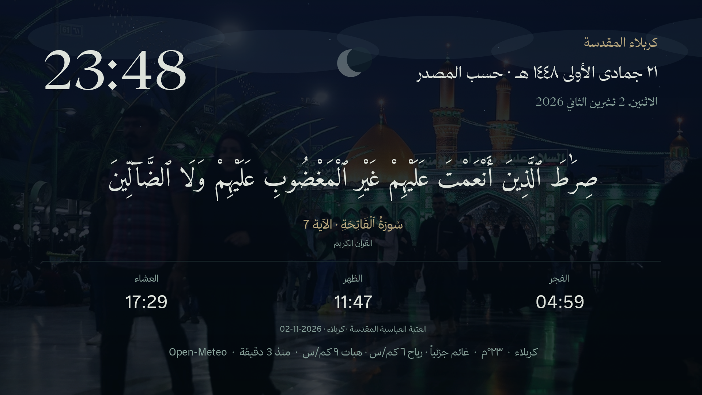
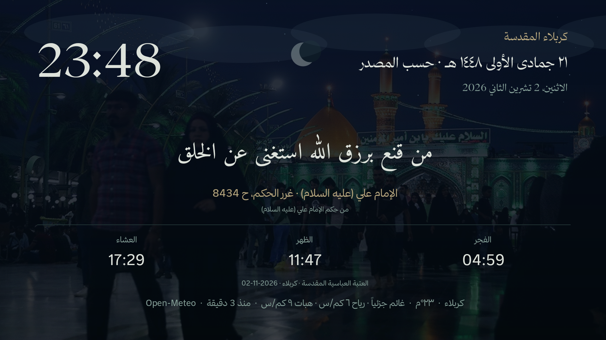
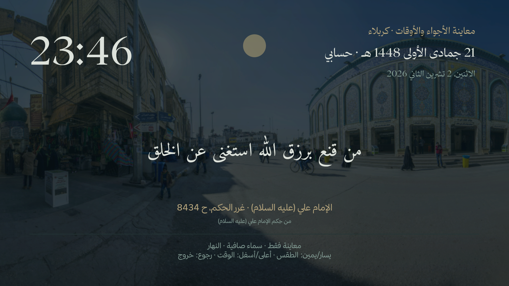
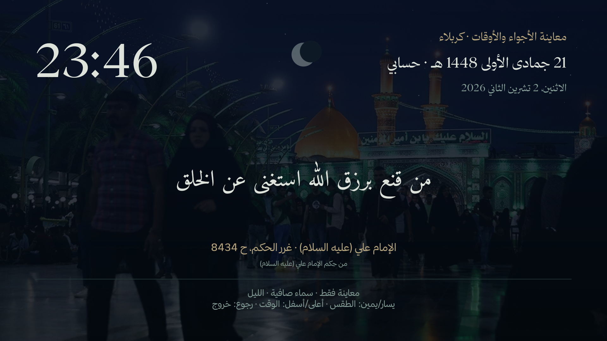

# Islamic TV | تلفزيون إسلامي

تلفزيون إسلامي للآيات والحِكم ومواقيت الصلاة والطقس، بشاشة توقف خفيفة لأجهزة **Android TV / Google TV بنظام Android8.0 أو أحدث**، مع واجهة رئيسية اختيارية قابلة لترتيب التطبيقات. ليست Firmware ولا تعمل كتطبيق Android على Samsung Tizen أو LG webOS.



> الصور لنسخة شخصية سابقة على تلفزيون حقيقي، لتوضيح الشكل والطقس والحِكم. النسخة العامة توسّع اختيار المدن والمحتوى وتستخدم خط أميري؛ قد تختلف الخطوط والقوائم عن الصور.

| حِكم ومراجع | أجواء النهار | أجواء الليل |
|---|---|---|
|  |  |  |

[تحميل آخر إصدار](https://github.com/malhaji129/islamic-tv/releases/latest) · [المصادر](CONTENT-SOURCES.md) · [الخصوصية](PRIVACY.md) · [المساهمة](CONTRIBUTING.md)

## التثبيت

1. افتح [الإصدارات](https://github.com/malhaji129/islamic-tv/releases/latest) وحمّل `Islamic-TV.apk` على تلفزيونك بواسطة USB أو Send Files to TV.
2. اسمح للتطبيق الذي يفتح الملف بتثبيت التطبيقات، ثم ثبّت APK. قد تختلف الخطوات حسب الشركة.
3. افتح «سكينة كربلاء» من مكتبة التطبيقات، وحدد المدينة بالبحث أو اقترحها عبر الإنترنت ثم أكّدها.
4. من إعدادات شاشة التوقف في التلفزيون اختر «سكينة كربلاء». قد تسمّيها الشركة شاشة السكون أو Daydream. المعاينة تعمل حتى إذا لم تعرض الشركة خيار شاشة توقف مخصص.
5. اختياري: ثبّت `TV-Home.apk` للواجهة الرئيسية، ثم اخترها كتطبيق Home إذا يدعم جهازك ذلك. أبقِ واجهة المصنع مفعّلة. [دليل الواجهة والترتيب والرجوع](docs/LAUNCHER.md).

لتحديث نسخة قديمة، يجب أن يكون التوقيع متطابقاً. النسخ الشخصية القديمة ونسخ GitHub العامة قد تحمل توقيعين مختلفين؛ ثبّت النسخة المناسبة أو احفظ إعداداتك قبل أي إزالة يدوية. لا تُمسح بيانات تطبيقات التلفزيون الأخرى.

## المدينة والمواقيت

- بحث يدوي بأسماء المدن مع عرض البلد والمنطقة الزمنية، أو تحديد تقريبي من الإنترنت يحتاج تأكيداً. لا حاجة إلى GPS.
- الساعة والتاريخ والطقس والشروق والغروب والأذان تتبع المنطقة الزمنية المختارة، بما فيها التوقيت الصيفي.
- كربلاء: اختيار صريح لمواقيت العتبة العباسية اليومية المؤرخة. الظهر هو وقت الظهرين المنشور، والعشاء وقت المغرب والعشاء المنشور. لا تُنسب هذه القيم إلى مدن أخرى.
- باقي المدن: مواقيت **محسوبة** من AlAdhan، افتراضياً جعفري، مع اختيار طريقة الحساب وتصحيح الدقائق. المصدر والطريقة ظاهران؛ طابقها مع الجهة الدينية المحلية التي تعتمدها.
- يُعرض الفجر والظهر والعشاء. الإمساك الرمضاني يوضّح هل مصدره منشور أم حسابي. التاريخ الهجري حسابي عند عدم وجود تاريخ منشور، مع تصحيح ±يومين؛ قد يختلف عن الرؤية.
- تغيير المدينة يلغي منبّهات المدينة القديمة ويعزل مخزون بياناتها. لا تُعرض مواقيت الأمس باسم اليوم.

## يستمر من آخر موضع

يحفظ التطبيق آخر آية أو حكمة والجزء الظاهر فور عرضه. عند إغلاق شاشة التوقف أو إعادة تشغيل التلفزيون يستأنف من الموضع المحفوظ ثم يكمل التناوب. تغيير فئة المحتوى أو تحديث المجموعة يحاول الاحتفاظ بنفس النص. المعاينة التوضيحية للأجواء لا تمس هذا الموضع.

## المحتوى والشكل

**6236 آية، و10096 قولاً متميزاً من غرر الحكم ودرر الكلم، و10 مقتطفات دعائية.** يظهر اسم السورة ورقم الآية، أو صفحة الكتاب والفقرة المحلية. النصوص الطويلة مقسّمة إلى أجزاء واضحة بلا إعادة صياغة. يُحفظ آخر موضع قراءة ويستأنف بعد إغلاق الشاشة أو إعادة التشغيل، ولا تغيّره معاينة الأجواء. العدد يشير إلى نصوص متميزة في المصدر، وليس شهادة بصحة سند كل قول. [تفاصيل المصادر والتحقق](CONTENT-SOURCES.md).

صور حقيقية للحرمين الحسيني والعباسي وبين الحرمين، تختار صور النهار والغروب والليل. مؤثرات خفيفة للصحو والغيوم والضباب والرذاذ والمطر والتجمد والثلج والبرد والرعد والرياح والغبار النمذجي. ستة أجواء زمنية: السحر، الفجر، الشروق، النهار، الغروب والليل. تقسيماتها الجمالية لا تحدد أوقات الصلاة.

الريموت: يسار/يمين يغيّران النص في المعاينة، MENU يفتح الإعدادات، رجوع للخروج. «معاينة الأجواء والأوقات»: يسار/يمين للطقس، أعلى/أسفل للوقت. المعاينة معلّمة ولا تغيّر بيانات المدينة. يمكن إطفاء الصور والطقس والمؤثرات. أي زر ينهي شاشة التوقف الفعلية.

النسخة العامة تستخدم أميري المفتوح. خط ثمانية والتسجيل الصوتي الشخصي غير مرفقين لعدم وجود إذن عام لإعادة توزيع ملفاتهما. يبقى العرض صامتاً، وتظهر معاينة الأذان غير متاحة دون تسجيل محلي. [الرخص والحقوق](THIRD_PARTY_NOTICES.md). هذا مشروع مستقل لا يمثل العتبتين أو حقيبة المؤمن.

## السرعة والخصوصية

Native Java، بلا WebView أو فيديو خلفي أو blur أو GPS. الحركة بحد أقصى8إطارات/ثانية عند الحاجة وتتوقف بالخروج؛ صورة واحدة مفكوكة بحجم≤1280×720 و≤2MiB. الطقس أثناء الظهور بحد أقصى مرة كل نصف ساعة، والمنبّهات يديرها النظام. [الخصوصية والخدمات الخارجية](PRIVACY.md).

النسخة الشخصية السابقة اختُبرت على AiPlus4K Android11. النسخة العامة متعددة المدن تُفحص بالبناء وlint والاختبارات الآلية؛ دعم القوائم والأذونات يتفاوت بين الأجهزة، ولا ندّعي اختبار كل تلفزيون.

## البناء من المصدر

JDK17، Android SDK34/build-tools34، Gradle8.9 المرفق:

```sh
./gradlew --no-daemon testDebugUnitTest lintDebug assembleDebug
sh scripts/test-policy.sh
sh scripts/test-adhan.sh
sh scripts/test-atmosphere.sh
sh scripts/test-location.sh
sh scripts/test-content.sh
python3 scripts/validate-content.py
```

الملف الناتج `app/build/outputs/apk/debug/app-debug.apk`. لا تحتاج النسخة العامة مفاتيح API أو خطوطاً/تسجيلات خاصة. لبناء الواجهة الاختيارية: `cd launcher` ثم `./gradlew --no-daemon testReleaseUnitTest lintRelease assembleRelease`.

التوقيع للإصدار العام يدعم متغيرات البيئة `ISLAMIC_TV_KEYSTORE`, `ISLAMIC_TV_STORE_PASSWORD`, `ISLAMIC_TV_KEY_ALIAS`, `ISLAMIC_TV_KEY_PASSWORD`. لا تحفظ مفتاح توقيع داخل Git. يمكن استعمال `-PincludePrivateAssets=true` محلياً فقط للأصول التي تملك إذن استعمالها. مسارات الأدوات ومفاتيح التلفزيون والنسخ الاحتياطية مستثناة من Git.

## English

A native Android8+ TV screensaver with confirmed manual/IP-based city selection, city-local clock/Hijri/weather/solar phases, explicit Karbala published or selectable calculated prayer sources, a cited offline Arabic corpus, and an optional editable launcher. Download APKs from Releases. Keep the original launcher enabled. This is not TV firmware and does not support non-Android TV systems. Personal Thmanyah font files and the unlicensed archival audio are excluded from public builds. Source code MIT; third-party assets retain their own licenses.
